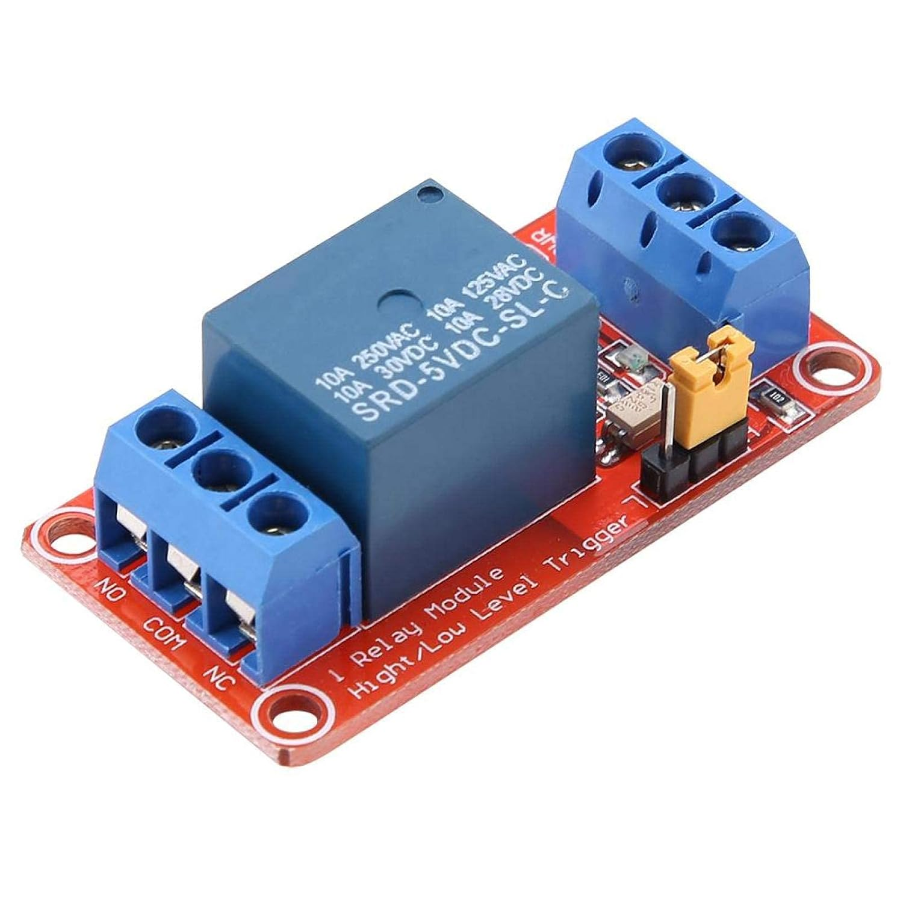

# Provisional Wiring Notes

The accompanying [provisional schematic](rolloffesp-provisional-schematic.svg) shows the proposed low-voltage connections for the current hardware description. It is a concept drawing, not a construction-ready electrical design.

## Relay module photo

The provided photo shows the one-channel opto-isolated relay board with a high/low trigger selector and an `SRD-05VDC-SL-C` relay:

The exact PCB revision and its control-header pin labels still need to be confirmed from the physical board or its datasheet.

## Assumptions used in the drawing

- Controller: Freenove ESP32 WROOM v1.3 development board, powered/programmed over USB-C.
- Relay: 1-channel, 5 V relay module with optocoupler isolation and selectable high-/low-level trigger, pictured above. The relay can marking is `SRD-05VDC-SL-C`; exact PCB revision, current consumption, input circuit, logic threshold, selected trigger mode, supply pins, and isolation/jumper topology are not yet confirmed. The intended coil/module supply is 5 V from the development board's VIN rail.
- Position switches: dry contacts, using COM and normally-open (NO) terminals. The stated 5 A / 125 V rating is a contact rating, not a signal voltage to apply to ESP32 pins.
- Indicators: green LED for the open switch contact, red LED for the closed switch contact, and red power LED for the USB-derived board power rail.
- Existing roof manual button: assumed to be a dry-contact input. The relay's COM/NO contact is drawn in parallel with the manual button to emulate a press. Verify the actual button circuit before connecting. The appliance cannot detect physical button presses, so manual operation during remote motion may desynchronize its inferred motion state until an endpoint switch is reached.
- Assigned GPIOs: GPIO25 drives the relay-module input; GPIO34 reads the roof-open switch; GPIO35 reads the roof-closed switch. GPIO25 is an output-capable, non-strapping pin. GPIO34/35 are input-only and have no internal pull-ups; the schematic therefore includes external 10 kΩ pull-ups. Confirm these GPIO numbers match the header labels on the exact Freenove board revision before wiring.
- The relay module's trigger selector can be set for high- or low-level operation. Select one mode, then configure the firmware's asserted and inactive output levels and any required pull resistor to match. The inactive level must not energize the relay during reset or boot.
- Confirm that the module's input recognizes 3.3 V GPIO levels and does not draw more current than a GPIO may safely source/sink.
- Preserve the module's optical isolation exactly as specified by its schematic. Follow its VCC/GND/jumper arrangement; do not add a ground connection across the isolation barrier.
- Connect module VCC to the board VIN/5 V rail as requested, subject to confirming the exact header label and the USB-C supply/board current budget. Follow the relay board's actual VCC/GND/jumper diagram; if its schematic requires a separate isolated supply, do not defeat that isolation by assuming a common rail/ground. Never power the relay coil from an ESP32 GPIO.
- The switch input resistors/capacitors are provisional filtering values. Validate input protection, cable length, grounding, and debounce on the actual installation. Use suitable protection for field wiring.
- The position LEDs are shown as switch-driven indicators from 3.3 V through individual current-limiting resistors to the corresponding active-low input nodes. Verify LED polarity and resistor values; the LEDs must not bypass or alter the required input levels.
- The red power LED is shown across the board's USB-derived 5 V rail and ground through a current-limiting resistor. Verify the board's power-rail access and total current budget.

## Electrical separation

The roof-control relay contact is a dry contact. Keep its COM/NO wiring electrically separate from the ESP32 power and GPIO ground unless the roof controller documentation explicitly requires another arrangement. Preserve the relay module's opto-isolation barrier and do not bypass it by joining grounds or bridging any isolation jumper. Do not connect motor power or 125 V to the ESP32, relay-module logic input, or switch GPIO circuit.

## Relay contact bench indicator

For bench testing only, the relay COM/NO contacts may switch a separate low-voltage LED indicator circuit: supply positive -> current-limiting resistor -> LED anode; LED cathode -> relay NO; relay COM -> supply return. The LED should illuminate when the relay closes COM to NO. Size the resistor for the selected supply and LED forward voltage/current. The contact is unpowered/dry, so an LED alone across COM/NO will not indicate closure. Keep the indicator supply and contacts disconnected from the roof controller and do not use roof or mains voltage for this test.

## Before connecting the roof

1. Confirm the Freenove board revision and verify GPIO25, GPIO34, and GPIO35 against its header pinout.
2. Confirm the pictured relay board's exact PCB revision and schematic/datasheet; verify the optocoupler wiring, trigger selector, required jumpers, logic input threshold/current, 5 V supply/current, contact rating, and galvanic separation.
3. Confirm the roof button terminals are a dry-contact, low-voltage control input and determine the effect/duration of a button press.
4. Confirm each limit switch's COM/NO/NC terminals and wire each only into the low-voltage input circuit.
5. Bench-test startup/reset relay-off behavior, input pull-ups, switch filtering, and relay press/release with the roof circuit disconnected.
6. Connect the relay contacts to the roof control circuit only after supervised electrical verification.
