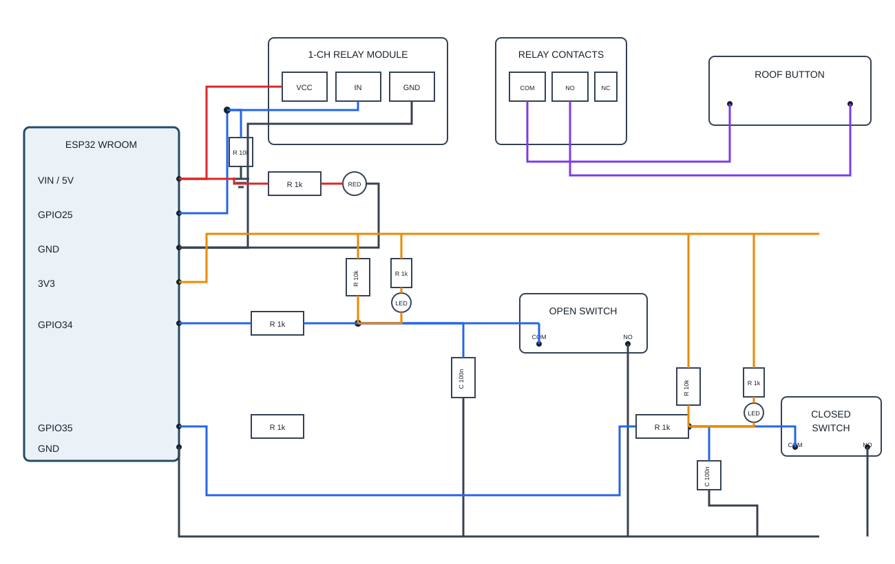

# Provisional Wiring Notes

The accompanying [provisional schematic](rolloffesp-provisional-schematic.svg) shows the proposed low-voltage connections for the current hardware description. It is a concept drawing, not a construction-ready electrical design.

For a component-to-component layout and wire-by-wire assembly checklist, see the [physical wiring diagram](physical-wiring-diagram.svg) and the [physical wiring schedule](#physical-wiring-schedule) below. The diagram is still provisional: relay header pin order and the exact board header positions must be checked on the actual hardware.

## Physical wiring schedule

Disconnect USB power while assembling. Use insulated terminals or a prototyping board for the resistors and capacitors; do not leave bare leads able to short. Wire by the silk-screened pin names on the actual ESP32 board and relay module, not by apparent pin position in the drawing.

### Board and relay control

| From | To | Wire / note |
| --- | --- | --- |
| USB-C supply | ESP32 USB-C port | Board power/programming. Use a supply and cable suitable for the board and relay load. |
| ESP32 VIN / 5V | Relay module input-side VCC | Only after confirming the relay module's supply pin and the board's 5 V current budget. |
| ESP32 GPIO25 | Relay module IN | Verify the module recognizes 3.3 V and the firmware's selected active polarity matches the H/L jumper. |
| ESP32 GND | Relay module input-side GND | Only if the actual module input circuit specifies a common logic return. Do not connect this to relay COM/NO/NC or the roof controller. |
| ESP32 VIN / 5V | 1 kΩ power-LED resistor, then red LED anode | Connect the LED cathode to ESP32 GND. The resistor is in series; observe LED polarity. |

The relay module's input terminal labels and any VCC/JD-VCC jumper arrangement vary by board. The pictured module image does not establish its underside header pinout or supply topology. If the physical board has different terminals or a jumper, do not infer a wiring arrangement from the generic diagram; obtain and follow that board's schematic first.

### Relay inactive during reset and power-up

The relay has been observed to activate during ESP32 reboot. **Keep the relay COM/NO wires disconnected from the roof controller until this is corrected and verified.** GPIO25 is high-impedance while the ESP32 is held in reset and before firmware initialization; software alone cannot guarantee the relay input level during that interval.

The firmware is configured for active-high relay operation: GPIO25 LOW is inactive and HIGH activates the relay. Remove any pull-up from GPIO25 to 3V3. For a compatible active-high module input, add an external pull-down resistor (typically 4.7–10 kΩ) from relay IN/GPIO25 to ESP32 GND, so the input remains inactive while GPIO25 is floating. Confirm the relay module input schematic, 3.3 V compatibility, and correct logic-side reference first. **Do not connect GPIO25 to VIN/5 V.** If the module input circuit has an internal pull-up or otherwise cannot be held safely LOW, use a suitable interface circuit rather than connecting it directly. Firmware also enables the ESP32's internal inactive-level bias and preloads the inactive output latch before configuring GPIO25 as an output; this is supplementary and does not replace the external reset-time bias.

After adding a verified hardware bias, test repeated power-on, reset-button, USB reconnect, and firmware-flash cycles with relay contacts disconnected from the roof. Confirm the relay never clicks or closes COM/NO except during an explicit, supervised bench pulse. Do not reconnect the roof until these tests pass.

### Open limit switch and green LED

Build an open-switch sense node (`OPEN_NODE`) using this net list:

1. ESP32 3V3 -> 10 kΩ pull-up resistor -> `OPEN_NODE`.
2. `OPEN_NODE` -> 1 kΩ series resistor -> ESP32 GPIO34.
3. `OPEN_NODE` -> one side of a 100 nF capacitor; the other capacitor lead -> ESP32 GND.
4. `OPEN_NODE` -> OPEN switch COM; OPEN switch NO -> ESP32 GND. Leave NC unused.
5. ESP32 3V3 -> 1 kΩ LED resistor -> green LED anode; green LED cathode -> `OPEN_NODE`.

When the OPEN switch closes, it pulls `OPEN_NODE` low, lights the green LED, and GPIO34 reads low. The switch is a dry contact in this low-voltage sensing circuit; do not apply the switch's 125 V contact rating to the GPIO.

### Closed limit switch and red LED

Build this as a separate circuit; do not connect the two sense nodes together:

1. ESP32 3V3 -> 10 kΩ pull-up resistor -> `CLOSED_NODE`.
2. `CLOSED_NODE` -> 1 kΩ series resistor -> ESP32 GPIO35.
3. `CLOSED_NODE` -> one side of a 100 nF capacitor; the other capacitor lead -> ESP32 GND.
4. `CLOSED_NODE` -> CLOSED switch COM; CLOSED switch NO -> ESP32 GND. Leave NC unused.
5. ESP32 3V3 -> 1 kΩ LED resistor -> red LED anode; red LED cathode -> `CLOSED_NODE`.

When the CLOSED switch closes, it pulls `CLOSED_NODE` low, lights the red LED, and GPIO35 reads low.

### Relay contacts and roof button

Run two separate contact wires from the relay module's screw terminals to the two terminals of the existing roof manual button: relay COM -> one button terminal, and relay NO -> the other button terminal. This places the relay contact in parallel with the manual button. Leave NC unused. These are dry contacts: they do not supply a voltage. Do not connect either contact to ESP32 VIN, 3V3, GPIO, or GND. Confirm the roof controller button is a suitable low-voltage dry-contact input before connecting.

### Parts for the illustrated circuits

- 2 x 10 kΩ pull-up resistors for the position inputs
- 1 x 10 kΩ pull-down resistor for relay reset bias (only after confirming module compatibility)
- 5 x 1 kΩ resistors (two GPIO series resistors, two position-LED resistors, one power-LED resistor)
- 2 x 100 nF capacitors
- 1 x green LED (OPEN), 2 x red LEDs (CLOSED and power)
- Insulated wiring/terminals for the board, relay input, switches, and isolated relay contacts

## Relay module photo

The provided photo shows the one-channel opto-isolated relay board with a high/low trigger selector and an `SRD-05VDC-SL-C` relay:

The exact PCB revision and its control-header pin labels still need to be confirmed from the physical board or its datasheet.

## Assumptions used in the drawing

- Controller: Freenove ESP32 WROOM v1.3 development board, powered/programmed over USB-C.
- Relay: 1-channel, 5 V relay module with optocoupler isolation and selectable high-/low-level trigger, pictured above. The relay can marking is `SRD-05VDC-SL-C`; exact PCB revision, current consumption, input circuit, logic threshold, selected trigger mode, supply pins, and isolation/jumper topology are not yet confirmed. The intended coil/module supply is 5 V from the development board's VIN rail.
- Position switches: dry contacts, using COM and normally-open (NO) terminals. The stated 5 A / 125 V rating is a contact rating, not a signal voltage to apply to ESP32 pins.
- Indicators: green LED for the open switch contact, red LED for the closed switch contact, and red power LED for the USB-derived board power rail.
- Existing roof manual button: assumed to be a dry-contact input. The relay's COM/NO contact is drawn in parallel with the manual button to emulate a press. Verify the actual button circuit before connecting. The appliance cannot detect physical button presses, so manual operation during remote motion may desynchronize its inferred motion state until an endpoint switch is reached.
- Assigned GPIOs: GPIO25 drives the relay-module input; GPIO34 reads the roof-open switch; GPIO35 reads the roof-closed switch. GPIO25 is an output-capable, non-strapping pin. GPIO34/35 are input-only and have no internal pull-ups; the schematic therefore includes external 10 kΩ pull-ups. Confirm these GPIO numbers match the header labels on the exact Freenove board revision before wiring.
- The relay module's trigger selector and firmware are configured for active-high operation. GPIO25 LOW is inactive; HIGH triggers the relay. Use a compatible external pull-down to GND for reset bias, and remove any GPIO25 pull-up. Verify this matches the actual module behavior before use.
- Confirm that the module's input recognizes 3.3 V GPIO levels and does not draw more current than a GPIO may safely source/sink.
- Preserve the module's optical isolation exactly as specified by its schematic. Follow its VCC/GND/jumper arrangement; do not add a ground connection across the isolation barrier.
- Connect module VCC to the board VIN/5 V rail as requested, subject to confirming the exact header label and the USB-C supply/board current budget. Follow the relay board's actual VCC/GND/jumper diagram; if its schematic requires a separate isolated supply, do not defeat that isolation by assuming a common rail/ground. Never power the relay coil from an ESP32 GPIO.
- The switch input resistors/capacitors are provisional filtering values. Validate input protection, cable length, grounding, and debounce on the actual installation. Use suitable protection for field wiring.
- The position LEDs are shown as switch-driven indicators from 3.3 V through individual current-limiting resistors to the corresponding active-low input nodes. Verify LED polarity and resistor values; the LEDs must not bypass or alter the required input levels.
- The red power LED is shown across the board's USB-derived 5 V rail and ground through a current-limiting resistor. Verify the board's power-rail access and total current budget.

## Electrical separation

The roof-control relay contact is a dry contact. Keep its COM/NO wiring electrically separate from the ESP32 power and GPIO ground unless the roof controller documentation explicitly requires another arrangement. Preserve the relay module's opto-isolation barrier and do not bypass it by joining grounds or bridging any isolation jumper. Do not connect motor power or 125 V to the ESP32, relay-module logic input, or switch GPIO circuit.

## Relay contact bench indicator

For bench testing only, the relay COM/NO contacts may switch a separate low-voltage LED indicator circuit: supply positive -> current-limiting resistor -> LED anode; LED cathode -> relay NO; relay COM -> supply return. The LED should illuminate when the relay closes COM to NO. Size the resistor for the selected supply and LED forward voltage/current. The contact is unpowered/dry, so an LED alone across COM/NO will not indicate closure. Keep the indicator supply and contacts disconnected from the roof controller and do not use roof or mains voltage for this test.

## Before connecting the roof

1. Confirm the Freenove board revision and verify GPIO25, GPIO34, and GPIO35 against its header pinout.
2. Confirm the pictured relay board's exact PCB revision and schematic/datasheet; verify the optocoupler wiring, trigger selector, required jumpers, logic input threshold/current, 5 V supply/current, contact rating, and galvanic separation.
3. Confirm the roof button terminals are a dry-contact, low-voltage control input and determine the effect/duration of a button press.
4. Confirm each limit switch's COM/NO/NC terminals and wire each only into the low-voltage input circuit.
5. Bench-test startup/reset relay-off behavior, input pull-ups, switch filtering, and relay press/release with the roof circuit disconnected.
6. Connect the relay contacts to the roof control circuit only after supervised electrical verification.
